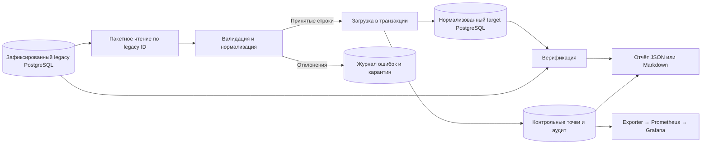

# Data Migration Pipeline

Система пакетной миграции данных между PostgreSQL-базами с нормализацией, восстановлением по контрольным точкам, проверкой целостности и отчётностью.

Система предназначена для перехода с устаревшей CRM на новую схему. Источник и назначение работают в независимых экземплярах PostgreSQL. Схемы и сценарий разработаны для этой системы. Для разработки и испытаний используются синтетические данные.

CLI проверяет подключения, применяет схемы, готовит синтетический снимок, загружает его в target и сохраняет итог сверки. Состояние реализации описано в [журнале разработки](docs/implementation-status.md).

## Архитектура



Данные партии, журнал отклонений и checkpoint фиксируются одной транзакцией target. Повторная загрузка неизменного снимка сохраняет значения и UUID записей. Правила чтения, трансформации и идемпотентности приведены в [стратегии миграции](docs/migration-strategy.md), схемы обеих БД показаны в [ER-диаграммах](docs/database-schema.md).

## Технологии

Python 3.12+, Typer и Rich для CLI, SQLAlchemy Async и asyncpg для PostgreSQL 16, Alembic для схем, Faker для синтетических данных, pytest и Ruff для проверок. Docker Compose запускает базы и опциональный мониторинг. Бенчмарк использует psutil, графики строятся через Matplotlib. Зависимости зафиксированы в `uv.lock`.

## Быстрый старт

Понадобятся Docker с Compose и, для запуска CLI на хосте, Python 3.12+ и uv.

```bash
cp .env.example .env
```

Задайте в `.env` отдельные пароли для администратора и прикладной роли каждой базы перед первым запуском. Compose создаёт роли при инициализации пустых томов. Для действующего тома пароль роли меняется в PostgreSQL и затем в `.env`.

```bash
docker compose up -d --wait legacy-db target-db
docker compose run --rm --build schema-init
docker compose run --rm migration-runner check
```

CLI также можно запустить на хосте из корня проекта.

```bash
uv sync --locked
uv run --locked migration-pipeline --help
uv run --locked migration-pipeline init
uv run --locked migration-pipeline check
```

| Сервис | Адрес на хосте | База по умолчанию | Прикладная роль |
| --- | --- | --- | --- |
| `legacy-db` | `127.0.0.1:55432` | `legacy_crm` | `legacy_reader` |
| `target-db` | `127.0.0.1:55433` | `target_crm` | `target_writer` |

Роль источника читает таблицы схемы `public`. Роль назначения выполняет операции с данными и создаёт временные таблицы. Обычный сервис `migration-runner` получает прикладные учётные данные. Для применения DDL используются учётные данные владельцев из `.env` и разовый сервис `schema-init`.

Команда `init` применяет актуальные ревизии Alembic отдельно к legacy и target. Повторный запуск проверяет состояние схем и применяет оставшиеся ревизии. Схемы, ключи и правила фиксации источника описаны в [документации PostgreSQL](docs/database-schema.md).

Команда `check` показывает доступность и версию каждой БД. Таймаут подключения и запросов задаётся через `DB_TIMEOUT_SECONDS`. Код выхода `0` означает, что обе базы доступны и работают на PostgreSQL 16. Код `1` означает проблему подключения или версию вне требований. Код `2` означает ошибку конфигурации.

Для остановки сервисов с сохранением данных используйте `docker compose stop`.

## Подготовка синтетических данных

После применения миграций запустите `seed` для пустой legacy-БД.

```bash
docker compose run --rm --build seed-runner seed --profile small --seed 42
```

Пример на хосте с 2% дефектных строк и повторяющимися email.

```bash
uv run --locked migration-pipeline seed --profile small --seed 42 --invalid-rate 0.02 --duplicate-contact-rate 0.1 --batch-size 1000
```

Из каталога проекта можно также вызвать `uv run --locked python scripts/generate_legacy_data.py --profile small`.

| Профиль | Клиенты | Заказы | Платежи | События статусов |
| --- | ---: | ---: | ---: | ---: |
| `small` | 1 000 | 5 000 | 5 000 | 10 000 |
| `medium` | 10 000 | 50 000 | 50 000 | 100 000 |
| `large` | 100 000 | 250 000 | 150 000 | 500 000 |

По умолчанию `seed` использует профиль `small`, значение seed `42`, пакет из 1 000 строк и нулевые доли дефектов и повторов. Large содержит 500 000 основных записей и запускается явным выбором `--profile large`.

Команда выводит прогресс по таблицам, сверяет фактическое число строк и возвращает UUID зафиксированного снимка. События запуска и завершения выводятся в stderr в формате JSON. Для другого набора используйте отдельную пустую legacy-БД. Алгоритм воспроизводимости и правила внесения ошибок описаны в [документации схем](docs/database-schema.md#синтетические-данные).

## Чтение источника

Команда `extract` читает выбранную сущность из зафиксированного снимка и показывает строку с количеством партий, числом записей и последним ID.

```bash
uv run --locked migration-pipeline extract --entity orders --batch-size 500
uv run --locked migration-pipeline extract --entity orders --batch-size 500 --after-id 2000
```

Для запуска из контейнера используйте обычную роль чтения `migration-runner`.

```bash
docker compose run --rm --build migration-runner extract --entity customers --batch-size 1000
```

Доступные сущности — `customers`, `orders`, `payments` и `status_history`. Параметр `--after-id` исключает переданную запись, а `--snapshot-id` сверяет UUID источника с ожидаемым значением. События чтения в stderr содержат метаданные партий. Подробности приведены в [стратегии чтения](docs/migration-strategy.md#пакетное-чтение).

## Проверка трансформаций

Команда `transform` читает зафиксированный снимок и проверяет преобразование клиентов, заказов, платежей и истории статусов. Для проверки связей и дубликатов она использует временные таблицы PostgreSQL. Сводка показывает количество принятых и отклонённых записей.

```bash
uv run --locked migration-pipeline transform --policy strict --batch-size 1000
docker compose run --rm --build migration-runner transform --policy skip --batch-size 1000
```

Для дефектного набора можно сохранить карантин и отчёт о совпадающих email в новые файлы JSONL.

```bash
uv run --locked migration-pipeline transform --policy quarantine \
  --quarantine-file quarantine.jsonl --duplicates-file duplicates.jsonl
```

Карантин содержит технические ID и коды ошибок. Отчёт о совпадениях содержит ID клиентов в каждой группе. Форматы, правила и коды выхода описаны в [стратегии трансформации](docs/migration-strategy.md#трансформация).

## Загрузка в target

Функция `load_batch()` записывает нормализованную партию в переданной транзакции PostgreSQL. Доступны одиночный и пакетный INSERT, UPSERT и COPY со staging. Повтор идентичной записи сохраняет существующий UUID target. Счётчики доступны по исходной сущности и по каждой целевой таблице.

Пример вызова и правила обработки конфликтов приведены в [стратегии загрузки](docs/migration-strategy.md#загрузка-в-target).

## Запуск миграции

После подготовки снимка выполните миграцию и проверьте состояние запуска.

```bash
uv run --locked migration-pipeline migrate --batch-size 1000 --strategy upsert
uv run --locked migration-pipeline status
```

```bash
docker compose run --rm --build migration-runner migrate --batch-size 1000 --strategy copy
docker compose run --rm migration-runner status
```

Команда `migrate` проверяет схемы, создаёт запуск и загружает записи в порядке их зависимостей. Каждая подтверждённая партия сохраняется в target вместе с записями об отклонениях и контрольной точкой. Для выборочного просмотра передайте UUID запуска в `status --run-id`.

По умолчанию `--policy strict` останавливает загрузку на первом отклонении. С `--policy skip` отклонения записываются как ошибки, а с `--policy quarantine` получают признак карантина. Команда возвращает код `0` после завершения загрузки со статусом `LOADED`, код `1` при сбое и `2` при неверных параметрах. `LOADED` означает, что все партии обработаны и запуск готов к верификации.

Зафиксированный снимок можно повторно загрузить отдельным запуском. Идентичные строки учитываются как неизменённые. Детали транзакции и состояния описаны в [стратегии миграции](docs/migration-strategy.md#запуск-и-контрольные-точки).

## Возобновление

После прерывания возобновите сохранённый запуск по его UUID.

```bash
uv run --locked migration-pipeline resume --run-id "$RUN_ID"
uv run --locked migration-pipeline status --run-id "$RUN_ID"
```

Укажите в `RUN_ID` UUID из сообщения о запуске или вывода `status`. Команда проверяет сохранённую конфигурацию и UUID снимка, затем берёт курсор и номер партии из target. Для завершённого запуска `resume` возвращает сохранённый результат.

Временные ошибки повторяются с экспоненциальной задержкой. При новом запуске параметры задаются через `--max-retries` и `--retry-delay`. По умолчанию допускаются три повтора с начальной задержкой 0,25 секунды. Порядок восстановления и лабораторная проверка описаны в [руководстве по восстановлению](docs/recovery.md).

## Верификация миграции

После загрузки со статусом `LOADED` запустите сверку по UUID. Перед первым запуском после обновления примените схему командой `migration-pipeline init`.

```bash
uv run --locked migration-pipeline verify --run-id "$RUN_ID"
uv run --locked migration-pipeline verify --run-id "$RUN_ID" --json
```

Команда проверяет полноту по legacy ID, аудит отклонений, внешние связи, денежные значения и контрольные суммы восьми целевых таблиц. Итог `SUCCESS`, `SUCCESS_WITH_REJECTIONS` или `FAILED_VERIFICATION` сохраняется вместе с отчётом в target. Первые два статуса дают код выхода `0`, расхождения дают `1`. Формат отчёта и порядок повторной сверки описаны в [документации верификации](docs/verification.md).

## Итоговые отчёты

Команда `report` читает сохранённый запуск по UUID. Она выводит счётчики, скорость, пиковый RSS, контрольные точки, ошибки, повторы и результаты верификации.

```bash
uv run --locked migration-pipeline report --run-id "$RUN_ID" --output migration-report.md
uv run --locked migration-pipeline report --run-id "$RUN_ID" --format json --output migration-report.json
```

Определения показателей и построение графиков описаны в [руководстве по отчётам](docs/reporting.md).

## Бенчмарки стратегий

Команда `benchmark` запускается с хоста из исходного каталога проекта при работающем локальном Docker с Compose. Она сравнивает четыре стратегии на одном синтетическом снимке и проверяет результат каждого прогона. Временный стенд создаётся и удаляется автоматически.

```bash
uv run --locked migration-pipeline benchmark --profile small --repeats 2
uv run --locked migration-pipeline benchmark --profile medium --repeats 3
```

Отчёты `results.json`, `runs.csv` и `batches.csv` сохраняются в `benchmarks/<UUID>`. Доступны [методика бенчмарков](docs/benchmarking.md) и [фактические результаты Small](benchmarks/6fde1748-c887-4ba2-8776-da5a6887043b/results.json).

## Мониторинг

После `init` включите профиль `monitoring` для запуска отдельного exporter, Prometheus и Grafana.

```bash
docker compose --profile monitoring up -d --build metrics-exporter prometheus grafana
```

Grafana открывается на `http://localhost:3000`, Prometheus на `http://localhost:9090`. Дашборд «Миграция данных» загружается автоматически. Обычные команды миграции работают независимо от профиля. Семантика показателей, параметры подключения и отдельный запуск exporter описаны в [руководстве по мониторингу](docs/monitoring.md).

## Команды CLI

| Команда | Назначение |
| --- | --- |
| `check`, `init` | Проверить подключение и применить схемы |
| `seed`, `extract`, `transform` | Подготовить снимок, прочитать источник и проверить преобразования |
| `migrate`, `resume`, `status` | Загрузить данные, продолжить запуск и прочитать состояние |
| `verify`, `report` | Проверить целостность и экспортировать отчёт |
| `benchmark`, `benchmark-charts` | Измерить стратегии и построить графики из замеров |
| `serve-metrics` | Запустить отдельный exporter метрик |

## Проверки

```bash
uv run --locked ruff check .
uv run --locked ruff format --check .
uv run --locked pytest
```

Интеграционные проверки запускаются на отдельном тестовом стенде PostgreSQL 16 с применёнными миграциями и открытым снимком legacy. Укажите конфигурацию этого стенда в `MIGRATION_TEST_ENV_FILE`.

```bash
MIGRATION_TEST_ENV_FILE=/path/to/test.env uv run --locked --extra charts pytest \
  --cov=migration_pipeline --cov-fail-under=80
```

GitHub Actions запускает Ruff, тесты, сценарий Small, генерацию графиков и сборку Docker-образа при push, pull request и ручном запуске. Для CI используются отдельные PostgreSQL и временные учётные данные. [Workflow](.github/workflows/ci.yml).

## Результаты

Сквозной запуск Small через COPY обработал **21 000 исходных записей** и подтвердил **38 669 строк target**. Все пять обязательных проверок пройдены со статусом `SUCCESS`. [Отчёт Markdown](reports/small/migration-report.md), [отчёт JSON](reports/small/migration-report.json).

На Small медианная скорость загрузки составила **139 записей/с** для одиночного INSERT, **1 267** для пакетного INSERT, **1 247** для UPSERT и **2 368** для COPY. Порядок прогонов и ресурсы стенда описаны в [результатах бенчмарка](docs/benchmarking.md#измеренный-эксперимент-small).

Генератор Large создал **500 000 основных записей** и **500 000 событий истории**. Замеры производительности Medium и Large — `NOT_MEASURED`.

## Дорожная карта

Двенадцать этапов реализации и результаты проверок зафиксированы в [журнале разработки](docs/implementation-status.md). Для следующих замеров объёма, нагрузки и инфраструктуры доступны отдельные запуски `benchmark` с соответствующим профилем.
