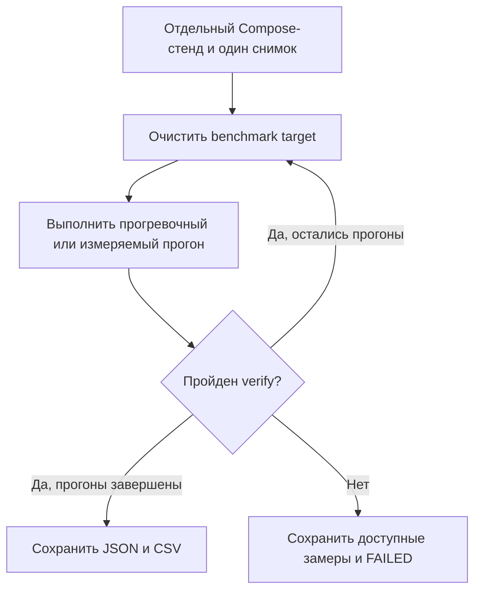
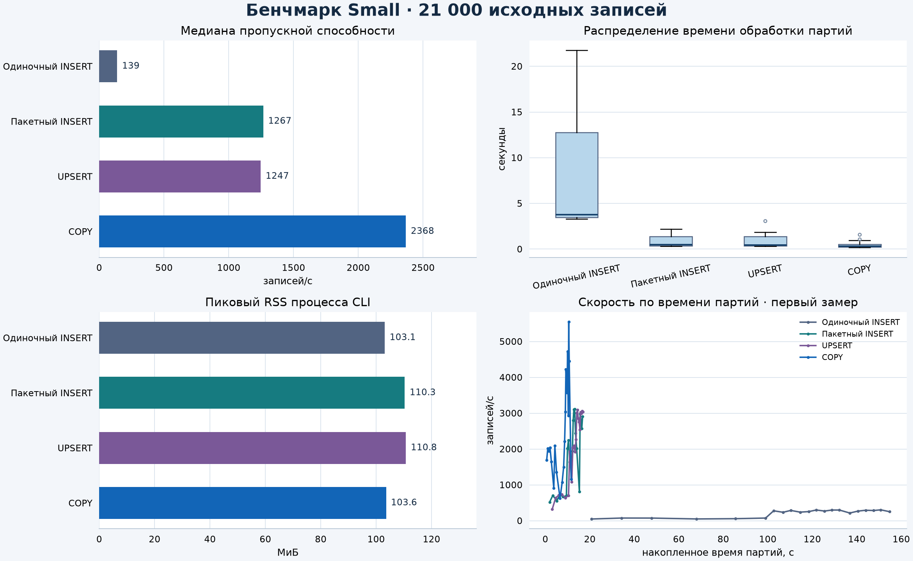

# Бенчмарки загрузки

Бенчмарк использует те же стратегии, преобразования и проверки, что команды `migrate` и `verify`. Базовый набор включает одиночный INSERT, пакетный INSERT, UPSERT и COPY через staging с последующим объединением.

## Запуск

Запускайте команду с хоста из checkout проекта. Нужны локальный Docker Engine и Docker Compose. PostgreSQL запускается в отдельном временном Compose-проекте на случайных портах loopback. Стенд получает собственную конфигурацию с новыми базами и учётными данными.

```bash
uv run --locked migration-pipeline benchmark --profile small --seed 42 --batch-size 1000 --repeats 2
uv run --locked migration-pipeline benchmark --profile medium --repeats 3 --warmups 1
uv run --locked migration-pipeline benchmark --profile small --strategy upsert --strategy copy
```

По умолчанию используются Small, seed `42`, партия из 1 000 строк, один прогрев и три измеряемых прогона на стратегию. Флаг `--strategy` можно повторять. `--output-dir` меняет родительский каталог отчётов. Код `0` означает, что весь эксперимент завершился и прошёл сверку, `1` означает ошибку выполнения или целостности, `2` означает неверные параметры.

| Профиль | Клиенты | Заказы | Платежи | История | Всего исходных записей |
| --- | ---: | ---: | ---: | ---: | ---: |
| Small | 1 000 | 5 000 | 5 000 | 10 000 | 21 000 |
| Medium | 10 000 | 50 000 | 50 000 | 100 000 | 210 000 |
| Large | 100 000 | 250 000 | 150 000 | 500 000 | 1 000 000 |

Large запускается явным `--profile large`. До генерации данных CLI предупреждает о нагрузке и показывает доступную память хоста, CPU, свободное место каталога отчётов и PostgreSQL, а также CPU и RAM, выделенные Docker Engine. PostgreSQL-сервисы используют общий бюджет Docker без отдельных ограничений контейнеров. При обычном старте проекта бенчмарки не запускаются.

## Методика



1. Синтетический набор генерируется один раз. Во всех прогонах используется его UUID и одинаковая конфигурация PostgreSQL.
2. Перед каждым прогоном очищаются целевые и служебные таблицы временной benchmark-БД. Очистка и подготовка происходят до начала замера.
3. Прогоны выполняются последовательно. Порядок стратегий сдвигается на каждом круге. Прогревочные прогоны сохраняются в отчёте с признаком `warmup` и исключаются из итоговых медиан. Процессы PostgreSQL сохраняются между прогонами, поэтому результаты относятся к сценарию с прогретым кэшем.
4. Время измеряется от входа в оркестратор до завершения загрузки. Сверка целостности и запрос размера БД выполняются вне этого интервала. Для статистики используются только измеряемые прогоны со статусом `SUCCESS` и ожидаемым числом записей.
5. Compose-проект, его контейнеры и тома удаляются после эксперимента. При ошибке верификации сохраняются доступные прогоны и итог `FAILED`.

| Показатель | Определение |
| --- | --- |
| Длительность и скорость | Время загрузки по монотонным часам. Записей в секунду — число обработанных исходных строк, включая историю, делённое на это время. |
| Время партии | От начала чтения до подтверждения партии, включая повторы. Для прогона сохраняются p50 и p95 по ближайшему рангу. Время чтения, трансформации, загрузки и транзакции сохраняется отдельными столбцами. |
| CPU и память | Замеры относятся к Python-процессу CLI. Сохраняются разница пользовательского и системного CPU-времени, начальный и пиковый RSS. Пик снимается с интервалом 50 мс и на границах замера. `100%` CPU соответствует одному полностью занятому логическому ядру. |
| Размер БД | `pg_database_size` целевой БД перед загрузкой и после неё, в байтах. |
| Ошибки и повторы | Доля отклонённых строк среди обработанных, статус прогона и число событий повторной попытки. |

Пакетные события сразу записываются во временные файлы. В памяти остаются агрегаты и компактный массив длительностей партий текущего прогона для расчёта перцентилей. Если при восстановлении результат COMMIT подтверждён без повторной записи, отсутствующие разбивки времени сохраняются как `null` в JSON и пустые поля в CSV. Полное время партии в этом случае включает повтор и сверку.

## Артефакты

- `results.json` содержит профиль, seed, UUID снимка, аппаратную конфигурацию хоста и Docker, параметры PostgreSQL, сводку и данные всех прогонов и партий.
- `runs.csv` содержит одну строку на прогон с фазой, порядком, длительностью, скоростью, CPU, RSS, размером БД, статусом и счётчиками ошибок.
- `batches.csv` содержит данные отдельных партий с UUID запуска, типом сущности и временами этапов.

Отчёты одного эксперимента публикуются вместе в отдельном каталоге. События прогресса пишутся в stderr. Результаты сравниваются внутри одного профиля и эксперимента. Для отсутствующих замеров используется `NOT_MEASURED`.

## Измеренный эксперимент Small

Seed 42, партия 1 000 строк, 21 000 исходных записей, PostgreSQL 16.16. Docker Desktop выделил 2 логических CPU и 5,8 ГиБ RAM. На каждую стратегию пришлись один прогрев и два измеряемых прогона.

| Стратегия | Медиана загрузки, с | Медиана, записей/с | Пик RSS CLI, МиБ |
| --- | ---: | ---: | ---: |
| Одиночный INSERT | 151,38 | 139 | 103,1 |
| Пакетный INSERT | 16,59 | 1 267 | 110,3 |
| UPSERT | 16,85 | 1 247 | 110,8 |
| COPY + staging + merge | 9,50 | 2 368 | 103,6 |



Все 12 прогонов прошли верификацию. JSON и CSV содержат 252 замера партий. Медиана скорости рассчитана по скоростям отдельных прогонов. Пиковый RSS в таблице — наибольший замер среди двух измеряемых прогонов. Medium и Large имеют статус `NOT_MEASURED` для этого эксперимента. [JSON](../benchmarks/6fde1748-c887-4ba2-8776-da5a6887043b/results.json), [CSV прогонов](../benchmarks/6fde1748-c887-4ba2-8776-da5a6887043b/runs.csv), [CSV партий](../benchmarks/6fde1748-c887-4ba2-8776-da5a6887043b/batches.csv).
