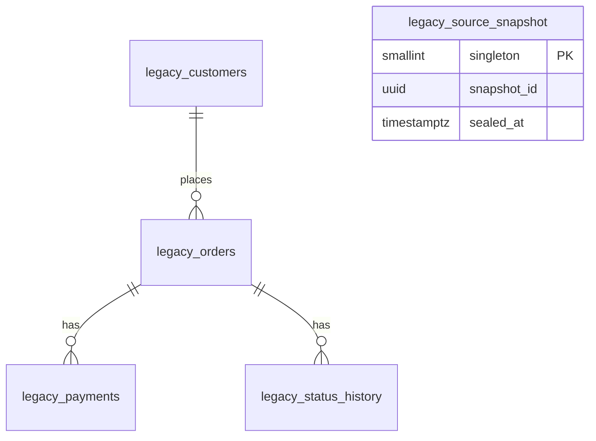
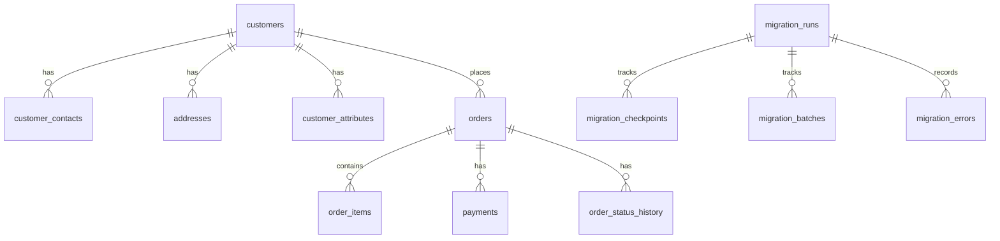

# Схемы PostgreSQL

Legacy и target размещаются в разных экземплярах PostgreSQL 16. Роль для извлечения читает legacy. Роль для загрузки пишет в бизнес- и служебные таблицы target и может читать версию Alembic.

## Источник



Первичные ключи `BIGINT` задаёт источник. Они подходят для чтения по курсору и привязки к идентификаторам новой схемы. Внешние ключи обеспечивают физическую целостность исходных заказов, платежей и событий.

Денежные значения и даты из старых полей хранятся как текст. Дополнительные атрибуты клиентов и позиции заказа хранятся в `JSONB`. Так схема сохраняет исходные форматы и допускает записи с некорректными значениями для последующей валидации.

### Неизменяемый снимок источника

В каждой legacy-БД хранится одна запись `legacy_source_snapshot`. Пока `snapshot_id` пуст, владелец может загрузить данные. После окончания загрузки владелец фиксирует снимок.

```sql
UPDATE public.legacy_source_snapshot
SET snapshot_id = gen_random_uuid(), sealed_at = clock_timestamp()
WHERE singleton = 1 AND snapshot_id IS NULL
RETURNING snapshot_id, sealed_at;
```

Операции записи в исходные таблицы удерживают разделяемую блокировку строки снимка до конца транзакции. Фиксация ждёт завершения этих транзакций. После неё PostgreSQL отклоняет `INSERT`, `UPDATE`, `DELETE` и `TRUNCATE` исходных таблиц. Повторное присвоение UUID, удаление и очистка записи снимка также блокируются.

Целевая таблица `migration_runs` хранит UUID источника в `source_snapshot_id`. При запуске и возобновлении ETL оркестратор будет сверять UUID с источником. Другой набор данных разворачивается в отдельной legacy-БД. Права владельца на DDL нужно контролировать отдельно, чтобы он сохранял защитные триггеры и исходные таблицы на протяжении миграции.

## Назначение



| Таблица | Ограничения и назначение ключей |
| --- | --- |
| `customers` | Уникальный `legacy_id`. Email индексируется и может совпадать у разных клиентов. Дата рождения и фамилия могут отсутствовать. |
| `customer_contacts` | Значение контакта уникально в рамках клиента и типа. Для каждого типа допустим один основной контакт клиента. |
| `addresses` | Сочетание клиента и частей адреса уникально, включая совпадающие `NULL`. Хотя бы одна часть адреса обязательна. |
| `customer_attributes` | Ключ `(customer_id, name)`. Каждое значение из `extra_data` сохраняется отдельной строкой с типом `JSONB`. |
| `orders` | Уникальный `legacy_order_id`. Сохраняются исходный номер, дата заказа `ordered_at` и время создания записи `created_at`. |
| `order_items` | Ключ `(order_id, line_number)` различает позиции с одинаковыми товарами. База проверяет положительное количество и равенство `line_total = quantity * unit_price`. |
| `payments` | Уникальные `legacy_payment_id` и `payment_reference`. Сохраняется способ платежа. Повтор ссылки платежа при разных legacy ID подлежит обработке как конфликт. |
| `order_status_history` | Уникальный исходный идентификатор события. Индекс по заказу, времени и исходному ID обеспечивает порядок при совпадении времени событий. |

Деньги хранятся в `NUMERIC(14,2)`. Целевые ограничения отклоняют отрицательные суммы и `NaN`. Время бизнес-событий хранится в `TIMESTAMPTZ`, дата рождения — в `DATE`.

## Состояние и версии схем

- `migration_runs` хранит UUID снимка, хеш конфигурации, итоговый статус и счётчики.
- `migration_checkpoints` хранит один курсор на запуск и тип сущности. Оркестратор будет сохранять курсор в транзакции с данными соответствующей партии.
- `migration_batches` хранит диапазон исходных ID, количество строк, статус и время подтверждения. Ключ партии состоит из ID запуска, типа сущности и номера партии.
- `migration_errors` хранит исходный ID, код, сообщение и признак карантина.

Целевая БД хранит бизнес-данные и состояние загрузки. UUID снимка связывает запуск с источником на уровне приложения. Граница транзакции загрузки проходит внутри target.

В `alembic.ini` заданы независимые истории ревизий `legacy` и `target`. Обе используют один исполнитель Alembic, а отдельные наборы миграций поставляются внутри Python-пакета и Docker-образа. В каждой БД хранится собственная таблица `alembic_version`. Прикладные роли могут читать таблицу версий, а изменяет её владелец.

`init` применяет ревизии в отдельной транзакции каждой БД. Если обновление второй базы завершилось ошибкой, после устранения причины повторный запуск начнёт с текущих ревизий обеих схем.

```bash
uv run --locked migration-pipeline init
uv run --locked alembic -n legacy current
uv run --locked alembic -n target current
```
