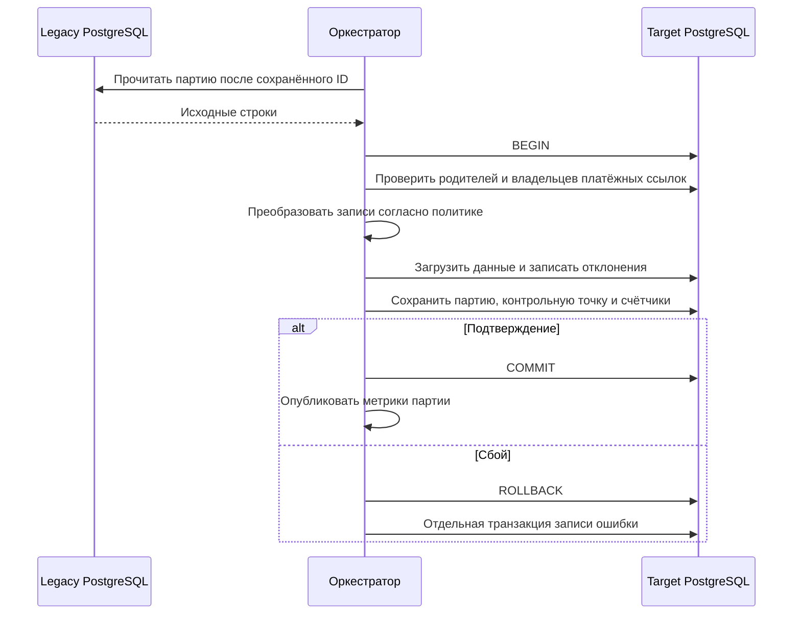

# Стратегия миграции

## Пакетное чтение

Слой извлечения использует SQLAlchemy AsyncIO и asyncpg. `open_legacy_source()` подключается ролью чтения к legacy, проверяет версию PostgreSQL 16 и текущую ревизию Alembic, затем читает UUID зафиксированного снимка. При возобновлении вызывающая сторона передаёт сохранённый UUID. Несовпадение останавливает чтение перед первой партией.

Каждая исходная сущность читается отдельно по своему первичному ключу.

| Сущность | Таблица | Ключ |
| --- | --- | --- |
| `customers` | `legacy_customers` | `legacy_id` |
| `orders` | `legacy_orders` | `legacy_order_id` |
| `payments` | `legacy_payments` | `legacy_payment_id` |
| `status_history` | `legacy_status_history` | `id` |

В начале чтения фильтр по ID отсутствует. После первой партии и при возобновлении чтения применяется строгая нижняя граница. Для заказов запрос имеет следующий вид.

```sql
SELECT *
FROM public.legacy_orders
WHERE legacy_order_id > :after_id
ORDER BY legacy_order_id
LIMIT :batch_size;
```

Диапазон по первичному ключу позволяет PostgreSQL использовать индекс. Порядок сохраняется при пропусках, отрицательных значениях и нуле в `BIGINT`. Размер партии задаётся в пределах от 1 до 10 000 строк. Каждая выборка ограничена своим `LIMIT`. Запросы выполняются в режиме autocommit, поэтому соединение может ждать обработку партии между запросами без открытой транзакции PostgreSQL. Зафиксированный снимок обеспечивает неизменность набора между запросами.

`extract_batches()` возвращает асинхронный итератор. Партия содержит исходные строки, номер, первый и последний ID и длительность чтения. Для продолжения передаются `after_id` и следующий номер партии. При миграции оркестратор будет брать курсор из контрольной точки целевой БД после подтверждения загрузки. Команда `extract` использует переданный пользователем курсор и выводит сводку чтения.

Событие `extract_batch` содержит `entity_type`, `batch_number`, `records_extracted`, `last_processed_id` и `extraction_duration_seconds`. CLI выводит событие в stderr в формате JSON с UUID снимка. Время включает запрос к PostgreSQL и получение строк партии.

## Трансформация

`transform_batch()` принимает исходные записи, известные ID принятых родителей и владельцев платёжных ссылок. Результат содержит нормализованные записи для загрузчика и технические сведения об отклонениях. Родительские связи передаются через исходные ID. При загрузке они сопоставляются с UUID целевой схемы.

| Сущность | Правила |
| --- | --- |
| Клиенты | Удаляются лишние пробелы. Имя из двух частей читается в порядке «имя, фамилия». Имя из одной или более двух частей сохраняется целиком в `first_name`, фамилия остаётся пустой. |
| Контакты и адреса | Email приводится к нижнему регистру после проверки структуры адреса. Разрешена пустая строка для необязательного контакта. Телефоны с явным международным префиксом проверяются по структуре номера. Национальные форматы распознаются для US, CA и RU, когда страна определена. Адрес сохраняется при наличии хотя бы одной части. Известные названия стран приводятся к коду. |
| Даты и атрибуты клиента | Проверяется дата рождения и порядок `created_at` / `updated_at`. Дополнительные атрибуты должны образовывать JSON-объект. Конфликт ключей после удаления пробелов отклоняет запись. |
| Заказы и позиции | Проверяются связь с клиентом, статус и трёхбуквенный код валюты. Позиции читаются как непустой JSON-массив и нумеруются по исходному порядку. Количество положительное. Сумма позиции вычисляется по цене и количеству, сумма заказа сверяется с позициями. При наличии исходной суммы позиции проверяется и она. |
| Платежи | Проверяются связь с заказом, статус, сумма и уникальность ссылки. Метод сохраняется после удаления внешних пробелов. Для завершённых и возвращённых платежей требуется дата. |
| История статусов | Нормализуются старый и новый статусы и время события. Пустой старый статус сохраняется как `NULL`, например для первого события. Для хронологии сохраняются время и исходный ID, который определяет порядок при одинаковых датах. |

Даты принимаются в ISO и текстовых форматах «день, месяц, год» с точками или косыми чертами. Время с указанным сдвигом переводится в UTC. Время без сдвига читается как UTC по соглашению источника. Для даты без времени используется полночь.

Денежные значения преобразуются в `Decimal` и проверяются для `NUMERIC(14,2)`. Для текстовых сумм допустима десятичная точка или запятая. Отрицательные значения, разделители тысяч, нечисловые суммы и значения, требующие округления, отклоняются. Дробные числа из PostgreSQL JSONB декодируются сразу в `Decimal`.

В статусах нормализуются пробелы и регистр. Помимо значений целевой схемы клиенты принимают `disabled` как `inactive` и `suspended` как `blocked`. Заказы принимают `new` как `pending`. Платежи принимают `paid` и `success` как `completed`, а `declined` как `failed`. В заказах, платежах и истории допустим вариант `canceled`, который становится `cancelled`.

### Повторы и политики ошибок

Идентичность клиента определяется его исходным ID. У принятых клиентов с одинаковым нормализованным email сохраняются отдельные записи. В отчёте о потенциальных дубликатах группа обозначается минимальным исходным ID, а строки отчёта содержат идентификаторы участников.

Платёжная ссылка сравнивается после удаления внешних пробелов с сохранением регистра. Если ссылка принадлежит другому legacy ID, запись получает код `payment_reference_conflict`. При проверке снимка владельцем становится первая принятая запись в порядке исходных ID. Новая запись с той же ссылкой обрабатывается выбранной политикой.

| Политика | Поведение |
| --- | --- |
| `strict` | Останавливает обработку на первом отклонении и возвращает код `1` при запуске из CLI. |
| `skip` | Пропускает отклонённую запись и учитывает её код в итоговых счётчиках. |
| `quarantine` | Пропускает отклонённую запись и сохраняет технические сведения в переданный JSONL-файл. |

Обработка идёт в порядке клиентов, заказов, платежей и истории. После проверки полей запись с отсутствующим или отклонённым родителем получает код `missing_parent`. Счётчики включают ошибки исходных полей и отклонения по связям.

`transform` проверяет связи и повторы между партиями во временных таблицах PostgreSQL в отдельной целевой сессии. При её завершении временные таблицы удаляются. При полном прохождении `skip` и `quarantine` возвращают код `0`, результаты и число отклонений публикуются в сводке. Код `2` означает ошибку параметров или конфигурации.

## Загрузка в target

Модуль `migration_pipeline.loaders.base` принимает записи одной сущности из `transform_batch()`. Клиенты загружаются перед контактами, адресами и атрибутами. Заказы загружаются перед позициями, платежами и историей. По исходным ID загрузчик получает UUID родителей из target. Отсутствующая связь останавливает партию.

| Стратегия | Метод записи |
| --- | --- |
| `insert` | Один INSERT на каждую новую строку. |
| `batch-insert` | Один INSERT с несколькими наборами значений. Объём одного запроса ограничен числом параметров PostgreSQL. |
| `upsert` | Пакетный INSERT с PostgreSQL `ON CONFLICT` по ключам записи. |
| `copy` | Бинарный COPY во временную таблицу с типами целевых столбцов и последующий `INSERT … SELECT … ON CONFLICT`. |

По умолчанию действует политика `verify`. Загрузчик сопоставляет значения по ключу и считает идентичные строки неизменёнными. Различие с существующей строкой, конфликт бизнес-ключа или ограничений откатывает партию. UUID уже сохранённых строк используются для дочерних записей. JSONB-атрибуты сохраняют дробные числа как числа с исходной точностью.

Политику `update` можно явно выбрать для UPSERT и COPY. Обновляются имя, email, дата рождения, статус и время изменения клиента, значение атрибута, номер, статус и сумма заказа, данные позиции, способ, статус, сумма и дата платежа. Для уже найденных строк сохраняются родительские связи, платёжная ссылка, валюта, исходные даты клиента и заказа и содержимое события истории. Адреса и контакты добавляются по ключам целевой схемы. Дочерние записи, отсутствующие во входной партии, сохраняются.

```python
from migration_pipeline.loaders.base import LoadStrategy, load_batch

async with target_engine.begin() as connection:
    result = await load_batch(
        connection,
        transformed_batch.records,
        strategy=LoadStrategy.COPY,
        transaction_timeout=60,
    )
```

Транзакция принадлежит вызывающему коду. Загрузчик использует savepoint, чтобы при ошибке отменить записи партии вместе с зависимыми строками. Транзакционная advisory-блокировка target сериализует вызовы загрузчика и миграции схемы в этой БД. Таймаут охватывает ожидание блокировки и операции партии. После таймаута вызывающая сторона завершает транзакцию откатом.

`LoadResult` содержит число вставленных, обновлённых и неизменённых исходных записей и такие же счётчики для каждой затронутой таблицы.

## Запуск и контрольные точки

Перед запуском оркестратор проверяет версии PostgreSQL и Alembic и UUID зафиксированного снимка. При необходимости ожидаемый UUID передаётся через `--snapshot-id`. В `migration_runs` сохраняются параметры загрузки и SHA-256 от их канонического JSON. В этот JSON входят размер партии, стратегия, политика ошибок, политика конфликтов и таймаут.

Логика подтверждения партии выполняется в target. Источник остаётся зафиксированным между запросами.



Курсор указывает на последний обработанный исходный ID. Он продвигается после обработки всей партии, включая строки, отклонённые по `skip` или `quarantine`. Сведения об отклонениях указывают на исходный ID и код ошибки. Отклонённый в текущем запуске родитель исключается при проверке дочерней записи.

`strict` откатывает текущую партию. Ошибка загрузчика или нарушение ограничения PostgreSQL также откатывает партию целиком. Если target доступна, оркестратор сохраняет причину и состояние `FAILED_MIGRATION` отдельной транзакцией. Подтверждённые партии и курсоры остаются доступными через `status`. После завершения загрузки запуск получает `LOADED`. Итоговые статусы верификации устанавливаются отдельным этапом.

Событие `migration_batch_committed` публикуется после подтверждения транзакции и содержит границу партии, счётчики и время чтения, преобразования, загрузки и транзакции. Автоматическое восстановление по UUID запуска относится к следующему этапу.
