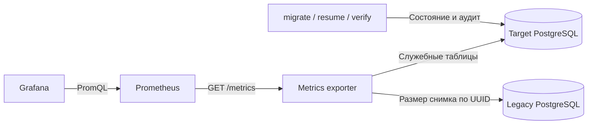

# Мониторинг миграции

Exporter читает журнал миграции из PostgreSQL и отдаёт его Prometheus по HTTP. Короткоживущие процессы `migrate`, `resume` и `verify` сохраняют состояние в target и работают независимо от мониторинга. Подтверждённые показатели доступны после завершения CLI и перезапуска exporter.



## Запуск в Docker

Поднимите базы и примените схемы согласно [быстрому старту](../README.md#быстрый-старт). Для первого запуска Grafana задайте `GRAFANA_ADMIN_PASSWORD` в `.env`. `GRAFANA_ADMIN_USER` по умолчанию равен `admin`.

```bash
docker compose --profile monitoring up -d --build metrics-exporter prometheus grafana
```

| Компонент | Подключение |
| --- | --- |
| Grafana | `http://localhost:3000`, дашборд «Миграция данных» в папке «Миграция» |
| Prometheus | `http://localhost:9090`, задача `migration` в разделе Targets |
| Metrics exporter | `http://metrics-exporter:9108/metrics` внутри сети Compose |

`GRAFANA_PORT` и `PROMETHEUS_PORT` меняют локальные порты. Compose публикует интерфейсы на loopback. Grafana получает источник Prometheus и дашборд из файлов проекта. История метрик и состояние Grafana хранятся в отдельных томах. [Provisioning Grafana](https://grafana.com/docs/grafana/latest/administration/provisioning/).

Prometheus опрашивает exporter каждые 10 секунд. `METRICS_DB_TIMEOUT_SECONDS` по умолчанию задаёт 4 секунды для чтения каждой базы. Для остановки только компонентов мониторинга выполните следующую команду.

```bash
docker compose --profile monitoring stop grafana prometheus metrics-exporter
```

## Метрики

| Метрика | Значение |
| --- | --- |
| `migration_records_processed_total` | Число обработанных исходных записей по всем запускам в target, включая обновлённые, неизменённые и отклонённые. |
| `migration_records_inserted_total` | Число вставленных исходных записей по всем запускам. Дочерние целевые строки в этот счётчик не входят. |
| `migration_records_rejected_total` | Число отклонённых записей в подтверждённых партиях. |
| `migration_batches_total` | Число подтверждённых партий по `entity_type`. |
| `migration_batch_duration_seconds` | Гистограмма времени от начала транзакции target до зафиксированного времени подтверждения партии. Границы заданы в секундах, разрез по `entity_type`. |
| `migration_errors_total` | Число записей аудита загрузки, включая отклонения и ошибки, прервавшие загрузку. |
| `migration_retries_total` | Число повторных попыток, сохранённых в аудите. |
| `migration_progress_percent` | Доля обработанных строк последней активной загрузки от размера её снимка. После окончания загрузки показывает `100`, включая случай последующей ошибки верификации. |
| `migration_records_per_second` | Средняя скорость подтверждения исходных строк за последние 60 секунд выбранной загрузки. Для завершённой загрузки окно заканчивается в момент её завершения. |
| `migration_exporter_target_up` | Доступность служебных таблиц target для exporter. |
| `migration_progress_available` | Доступность процента прогресса для выбранной загрузки. |
| `migration_run_state{status=…}` | Состояние загрузки с самой недавней активностью. Учитываются время старта, последняя контрольная точка и время окончания. |

Все показатели target читаются в одной транзакции `REPEATABLE READ`. Число строк legacy вычисляется по четырём таблицам и кешируется по проверенному UUID неизменяемого снимка. При отсутствии снимка или недоступной legacy проценты появляются после успешного чтения. Метки содержат только тип сущности или статус. UUID запусков, идентификаторы записей и тексты ошибок остаются в базе и логах CLI.

Prometheus показывает `up=0`, когда exporter недоступен. `migration_exporter_target_up=0` означает потерю доступа к журналу target при работающем exporter. В этом состоянии exporter отдаёт только сигнал доступности. При восстановлении соединения счётчики снова читаются из журнала. Архивирование или очистка журнала может сбросить наблюдаемые счётчики. Статус `RUNNING` берётся из журнала и сохраняется после аварийной остановки до следующего действия с запуском.

## Отдельный exporter и роль чтения

Exporter можно запустить отдельным процессом с настройками `LEGACY_DB__*` и `TARGET_DB__*`. Адрес по умолчанию `127.0.0.1:9108`.

```bash
uv run --locked migration-pipeline serve-metrics --host 127.0.0.1 --port 9108
```

В Compose exporter использует настройки target из `.env` внутри транзакции только для чтения. Для выделенной роли укажите `METRICS_TARGET_DB_USER` и `METRICS_TARGET_DB_PASSWORD`. Роли достаточно права подключения к базе, доступа к схеме `public` и чтения таблиц `migration_runs`, `migration_checkpoints`, `migration_batches`, `migration_errors` и `migration_retries`. Права чтения legacy совпадают с ролью извлечения снимка.
