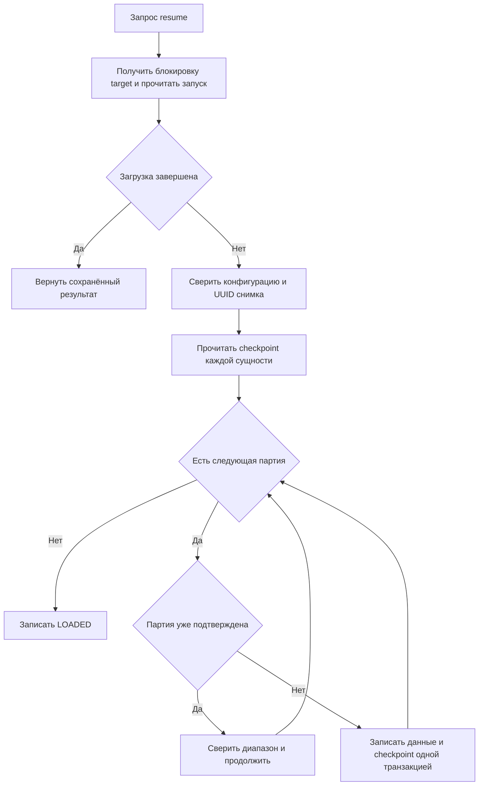

# Восстановление миграции

## Возобновление по UUID

Команда `status` показывает подтверждённые партии, счётчики и количество записанных повторов. Возобновление сохраняет UUID запуска и начинает каждую сущность с первого исходного ID после её checkpoint.

```bash
uv run --locked migration-pipeline status --run-id "$RUN_ID"
uv run --locked migration-pipeline resume --run-id "$RUN_ID"
```

Возобновить можно запуск со статусом `RUNNING` после прерывания или `FAILED_MIGRATION`. PostgreSQL удерживает блокировку на уровне сессии, пока миграция работает в target. Конкурирующая команда получает ошибку. При разрыве соединения блокировка освобождается, а при восстановлении соединения оркестратор получает её заново.

Перед обработкой сверяются хеш параметров и UUID снимка. Используются параметры исходного запуска. Запуски, созданные до добавления параметров повторов, используют для них значения по умолчанию. При несовпадении снимка или хеша состояние запуска сохраняется. Запуски с завершённой загрузкой возвращаются из target по тому же UUID.



## Временные ошибки

Автоматически повторяются временные сетевые ошибки, обрывы соединения, таймауты, блокировки и конфликты сериализации PostgreSQL. Политика задаётся при `migrate` через `--max-retries` и `--retry-delay`. Начальная задержка удваивается после каждой попытки и ограничена 10 секундами. Значение `--max-retries 0` оставляет одну попытку. Ошибки аутентификации, ограничения данных и остановка `strict` завершают текущую операцию.

Если связь пропала после COMMIT, повтор сверяет номер партии, диапазон ID, число строк и сохранённый checkpoint. Подтверждённая партия учитывается один раз. Повтор чтения открывает то же поколение источника по сохранённому UUID.

События `migration_retry` сразу публикуются в stderr. При доступном target они сохраняются в `migration_retries` вместе со следующей записью состояния. Если target недоступна и попытки исчерпаны, события доступны в stderr, а восстановление опирается на последний сохранённый checkpoint.

## Лабораторная проверка прерывания

На отдельном стенде с чистым Small следующий запуск завершится с кодом `75` после подтверждения 10 партий по 1 000 строк.

```bash
MIGRATION_LAB_MODE=true uv run --locked migration-pipeline migrate \
  --batch-size 1000 --strategy copy --fail-after-batches 10
```

Возьмите UUID из события `migration_lab_crash` и передайте его в `resume`. После прерывания `status` показывает 10 000 обработанных строк. После завершения на Small счётчик достигает 21 000 с учётом истории статусов.
